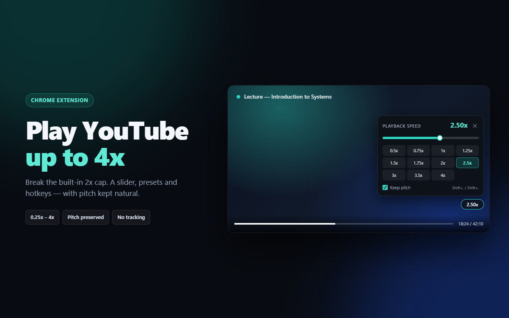

<p align="center">
  
</p>

<h1 align="center">Speed Master</h1>

<p align="center">
  <strong>YouTube playback speed, unlocked.</strong><br />
  A Manifest V3 Chrome extension that goes beyond YouTube's built-in 2x cap:<br />
  <strong>0.25x–4x</strong> from the player UI, up to <strong>16x</strong> from the console.
</p>

<p align="center">
  <a href="https://github.com/deba608/youtube-speed-master/releases"></a>
  <a href="manifest.json"></a>
  <a href="tests/qa.mjs"></a>
  <a href="PRIVACY.md"></a>
  <a href="LICENSE"></a>
</p>

<p align="center">
  <a href="#install">Install</a> ·
  <a href="#usage">Usage</a> ·
  <a href="#console-api">Console API</a> ·
  <a href="#development">Development</a> ·
  <a href="#qa">QA</a> ·
  <a href="#packaging--store-assets">Store package</a> ·
  <a href="#troubleshooting">Troubleshooting</a> ·
  <a href="ROADMAP.md">Roadmap</a>
</p>



## Features

- **Beyond 2x** — slider from 0.25x to 4x in 0.05x steps, plus 11 one-click presets
  (0.5 / 0.75 / 1 / 1.25 / 1.5 / 1.75 / 2 / 2.5 / 3 / 3.5 / 4).
- **Keyboard-first** — `Shift + .` / `Shift + ,` step the speed (0.05x–0.50x, configurable),
  `Shift + 0` resets, `Shift + 1`…`4` jump to 1x–4x.
- **In-player panel** — a compact speed pill opens a full panel; `Esc` or a click outside closes it.
- **Set it once** — choose a default speed in the toolbar popup; changes apply live to open tabs.
- **Make it yours** — options page for panel size (80–140%), transparency, left/right placement and
  auto-hide, with a live preview.
- **Per-channel memory** — opt in to “Remember this channel” and lectures keep 2.5x while music
  stays at 1.25x. Managed from the popup.
- **Your presets** — add or remove preset speeds (3–12, 0.25x–4x); one click restores defaults.
- **Backup and restore** — export speed, pitch, presets, channel memory and appearance settings to
  JSON, import it back, or reset everything.
- **Pitch stays natural** — pitch preservation is on by default and toggleable in the panel or popup.
- **Accessible** — labelled controls, live-region speed announcements and focus returned to the pill
  when the panel closes with `Esc`.
- **Ads stay at 1x** — the panel shows an `Ad · 1x` badge, then your speed returns after the ad.
- **Sticks to the video** — re-applies after SPA navigation, player rebuilds, `loadedmetadata` and
  YouTube resetting the rate. Works in fullscreen.
- **Private by design** — no account, analytics, telemetry, remote code or network requests of its
  own.

**Status:** v1.2.0 is packaged and available on GitHub. Distribution is the release ZIP for now;
the Chrome Web Store listing is deferred (one-time $5 developer fee). What comes next is in
[ROADMAP.md](ROADMAP.md).

New here? [GUIDE.md](GUIDE.md) covers install, controls, settings and troubleshooting in detail.

## Install

### From the release ZIP (recommended)

1. Download
   [`youtube-speed-master-1.2.0.zip`](https://github.com/deba608/youtube-speed-master/releases/latest/download/youtube-speed-master-1.2.0.zip)
   and extract it. Chrome cannot load a `.zip` directly.
2. Open `chrome://extensions` and enable **Developer mode**.
3. Click **Load unpacked** and select the extracted folder that **directly contains
   `manifest.json`** — not its parent.
4. Pin **Speed Master**, open a YouTube video and confirm the console logs
   `[Speed Master] ready`.

The packaged ZIP extracts flat. A GitHub **Code → Download ZIP** archive adds a nesting level, so
select the inner folder instead.

### From source (development)

```powershell
git clone https://github.com/deba608/youtube-speed-master.git
cd youtube-speed-master
npm install
```

Then load the repository folder with **Load unpacked** (`npm install` is only needed for the QA,
packaging and asset scripts). After editing `src/content.js` or `src/overlay.css`, click the reload
icon on the extension card and reload the YouTube tab.

Step-by-step instructions for Chrome, the ZIP, Edge and Brave:
[GUIDE.md § Install](GUIDE.md#install).

**Requirements:** desktop Chrome/Edge 88+ or another Chromium browser with Manifest V3 support.

## Usage

| Action | How |
|---|---|
| Open / close the panel | Click the speed pill in the player |
| Change speed | Drag the slider (0.25x–4x, 0.05x steps) |
| Jump to a common speed | Click a preset |
| Faster / slower | `Shift + .` / `Shift + ,` (step configurable) |
| Reset to 1x | `Shift + 0` |
| Jump to 1x / 2x / 3x / 4x | `Shift + 1` … `Shift + 4` |
| Close the panel | `Esc`, or click outside it |
| Natural or sped-up audio | **Keep pitch** in the panel or popup |
| Set the default for every video | Toolbar icon → slider, presets, **Reset 1x** |
| Change panel size / transparency / position | Toolbar icon → ⚙, or `chrome://extensions` → Details → Extension options |
| Remember a channel's speed | Open the panel on a video → **Remember this channel** |

Hotkeys are ignored while you type in a comment box, search field or the address bar. Changes made
from the panel, presets or hotkeys also become the saved default.

Only these values are stored:

| Key | Area | Meaning |
|---|---|---|
| `defaultRate` | `sync` | Speed applied to new videos (0.25–4 from the UI) |
| `preservesPitch` | `sync` | Keep audio natural (`true`) or let it rise (`false`) |
| `presets` | `sync` | Custom preset list (3–12 rates) |
| `uiScale`, `uiOpacity`, `uiPosition`, `uiAutoHide` | `sync` | Panel appearance |
| `hotkeysEnabled`, `hotkeyStep` | `sync` | Shortcut preference and step size |
| `channelRates` | `local` | Per-channel speeds plus channel names |

If Chrome sync is enabled, the `sync` keys follow your Chrome profile to other computers. Channel
memory stays on this device. The extension has no servers of its own. Export everything from the
popup as JSON.

### Speed limits

| Where | Range |
|---|---|
| Panel, popup, hotkeys | 0.25x – 4x |
| Console API (power users) | 0.0625x – 16x |

The UI deliberately stops at 4x; above that, video and audio quality drop sharply and YouTube's
player becomes unstable. See [Console API](#console-api) if you want to go higher.

## Console API

Open DevTools on a YouTube tab and switch the console context dropdown to **Speed Master**, then:

```js
__ytSpeedMaster.setRate(3);        // 3x (clamped to 0.0625–16)
__ytSpeedMaster.getRate();         // 3
__ytSpeedMaster.setPitch(false);   // let the audio rise with speed
__ytSpeedMaster.enable(false);     // pause the rate engine
__ytSpeedMaster.info();            // { desired, applied, defaultRate, channel, remembered, presets, ... }
__ytSpeedMaster.reset();           // back to 1x
__ytSpeedMaster.setPresets([1, 1.5, 2, 2.5, 3]);
__ytSpeedMaster.remember(true);    // save the current rate for this channel
__ytSpeedMaster.refreshChannel();  // re-read the owner link and apply its rate
```

From the page context, use the primitive-only bridge:

```js
document.dispatchEvent(new CustomEvent('ytsm', { detail: '3' }));      // set rate
document.dispatchEvent(new CustomEvent('ytsm', { detail: 'info' }));   // log state
document.dispatchEvent(new CustomEvent('ytsm', { detail: 'pitch off' }));
document.dispatchEvent(new CustomEvent('ytsm', { detail: 'off' }));    // disable
document.dispatchEvent(new CustomEvent('ytsm', { detail: 'reset' }));
```

Expected behaviour: the video keeps the speed across `loadedmetadata`, SPA navigation to another
video, and YouTube trying to reset it. Ads always play at 1x.

## How it works

The content script writes `video.playbackRate` directly, which Chromium accepts from `0.0625` to
`16` even though YouTube's UI stops at 2x. It also sets `preservesPitch` to keep audio natural.

YouTube actively resets the rate, so the engine:

- re-applies on `loadedmetadata`, `loadeddata`, `canplay`, `play` and `playing`;
- listens for `ratechange` and re-forces the desired value (with a loop guard);
- watches SPA navigation events (`yt-navigate-finish`, `yt-page-data-updated`);
- uses a `MutationObserver` plus a one-second safety net for rebuilt players;
- forces ads to 1x and restores your speed when the ad ends.

The extension is MV3, requests only the `storage` permission, and runs a content script on
`*://*.youtube.com/*`. There is no remote code and no page data is collected or transmitted.

## Development

| Command | What it does |
|---|---|
| `npm run check` | Syntax-check `src/content.js` and `src/popup.js` |
| `npm run qa` | Run the 61-check Playwright suite |
| `$env:QA_REAL='1'; npm run qa` | Add the real-YouTube smoke test (3 extra checks; can be flaky) |
| `npm run package` | Build `dist/youtube-speed-master-<version>.zip` |
| `npm run assets` | Re-render store screenshots and the promo tile |
| `npm run icons` | Regenerate the 16/32/48/128 px icons |

The packaging and icon scripts use PowerShell; the QA and asset scripts are cross-platform.

Dev harnesses (`scripts/engine-harness.html`, `scripts/storage-harness.html` and
`scripts/popup-harness.html`) exercise the real source without loading the extension. Serve the
repository root with any static server, then open the harness paths.

## QA

```powershell
npm install
npx playwright install chromium   # once
npm run qa                        # 61 automated checks
$env:QA_REAL = '1'; npm run qa    # + real youtube.com smoke test
```

The automated run loads the real unpacked extension into headless Chromium and serves a
YouTube-shaped fixture from `https://www.youtube.com:<port>` (DNS-mapped to localhost). That
exercises the manifest match rule, content script, storage and UI end to end: injection, rate
application, re-forcing, panel, slider, hotkeys, ads, video replacement, pitch, reload persistence,
two-tab sync, embed-shaped and Shorts-shaped pages.

Manual cases that need a human on real YouTube (live, Shorts, playlist, incognito, fullscreen):
[tests/MANUAL-QA.md](tests/MANUAL-QA.md).

## Packaging & store assets

```powershell
npm run package   # writes dist/youtube-speed-master-1.2.0.zip
```

The ZIP contains `manifest.json`, `src/` and `icons/` only — manifest at the root, no dev files. The
script verifies the required entries and fails if any are missing.

- Listing copy, permission justifications and data disclosures:
  [store/LISTING.md](store/LISTING.md)
- Dashboard walkthrough (deferred until the store fee is available): [store/PUBLISH.md](store/PUBLISH.md)
- Screenshots and promo tile: `store/`, regenerated with `npm run assets`
- Privacy policy (public): https://deba608.github.io/youtube-speed-master/privacy.html
- Source of the policy page: [docs/privacy.html](docs/privacy.html)
- Landing page: https://deba608.github.io/youtube-speed-master/

## Project layout

```text
manifest.json       MV3 manifest
src/content.js      rate engine + in-player overlay
src/overlay.css     overlay panel styles
src/popup.html      toolbar settings popup
src/popup.js        popup logic + chrome.storage.sync
src/popup.css       popup styles
src/options.html    appearance + keyboard settings page
src/options.js      options logic + live preview
src/options.css     options styles
icons/              16 / 32 / 48 / 128 px
scripts/            icon generator, packager, dev harnesses
tests/              Playwright QA, fixture, store-asset renderer, manual checklist
store/              listing copy, publishing guide, screenshots, promo tile
docs/               GitHub Pages site (landing + privacy policy)
GUIDE.md            user guide: install, controls, troubleshooting
ROADMAP.md          post-1.0 feature plan
PLAN.md             original plan and design notes
CHANGELOG.md        release history
PRIVACY.md          privacy policy
```

## Troubleshooting

| Symptom | Fix |
|---|---|
| No speed pill on a video | Reload the tab. Confirm the site is `youtube.com`, not a third-party embedded player. |
| Pill appears but speed snaps back | Another extension is also setting the playback rate. Disable it and reload. |
| Hotkeys do nothing | Click once inside the page first; hotkeys are disabled while a text field has focus. |
| Audio sounds sped up | Enable **Keep pitch** in the panel or the popup. |
| `Manifest file is missing or unreadable` | You selected the folder above the one containing `manifest.json`; go one level down. |
| Settings did not carry to another computer | Chrome sync must be enabled for the profile. |

Full troubleshooting table: [GUIDE.md § Troubleshooting](GUIDE.md#troubleshooting). Still stuck?
[Open an issue](https://github.com/deba608/youtube-speed-master/issues) with your Chrome version,
the video URL and any console errors.

## Privacy

Speed Master collects nothing: no analytics, no telemetry, no accounts, no servers, no remote code.
The only stored data is your playback preferences and optional channel memory. Full policy: [PRIVACY.md](PRIVACY.md) ·
https://deba608.github.io/youtube-speed-master/privacy.html

## Contributing

Bug reports and pull requests are welcome. Before opening a PR, run:

```powershell
npm run check
npm run qa
```

Keep the UI range at 0.25x–4x, ads at 1x, and avoid new permissions or remote code.

## Roadmap

Planned releases and the reasoning behind them: [ROADMAP.md](ROADMAP.md).

| Release | Focus |
|---|---|
| 1.1.0 | Per-channel speed memory, editable presets, ad hand-off hardening, export/import |
| 1.2.0 | Panel size/transparency/position, auto-hide, options page, keyboard preferences, accessibility |
| 1.3.0 | Localization, Firefox port, store asset refresh (store listings deferred) |
| 2.0.0 | Speed profiles and rules, custom shortcuts, temporary speed |

Constraints stay fixed: `storage` permission only, no remote code or analytics, ads at 1x, UI capped
at 4x.

## Changelog

Release history: [CHANGELOG.md](CHANGELOG.md).

## License

[MIT](LICENSE) © 2026 Deba608

---

Not affiliated with YouTube or Google. YouTube is a trademark of Google LLC.
